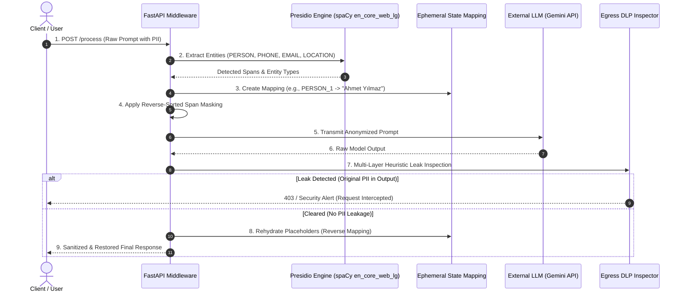

# PII Guard Middleware for LLMs

[](https://www.python.org/)
[](https://fastapi.tiangolo.com/)
[](https://github.com/microsoft/presidio)
[](https://opensource.org/licenses/MIT)
[](https://github.com/mfurkanerkan15/pii-guard-middleware/actions/workflows/ci.yml)

An HTTP proxy middleware built with FastAPI and Microsoft Presidio to implement data minimization for Large Language Model (LLM) integrations. The system anonymizes sensitive Personally Identifiable Information (PII) before external transmission, applies multi-layer heuristic checks on the model's response to detect inadvertent data leakage, and restores original values for the client.

---

## 🏗️ Architecture & Pipeline Flow

The proxy intercepts traffic at two points in the request lifecycle: **Ingress (Pre-LLM)** and **Egress (Post-LLM)**.



---

## 📁 Package Layout (`src/pii_guard/`)

The repository adopts a standardized `src/` layout:

```text
src/pii_guard/
├── __init__.py          # Package metadata (__version__ = "0.3.0")
├── api.py               # FastAPI application, lifespan handler, and /process endpoint
├── config.py            # Centralized settings via pydantic-settings
├── dlp.py               # Multi-layer egress DLP inspection engine
├── llm.py               # SDK-agnostic LLM wrapper isolating model calls
├── logging_config.py    # Zero-PII structured JSON audit logging
└── masking.py           # Ingress dynamic masking, lazy Presidio, and rehydration
tests/                   # Fully isolated automated test suite
pyproject.toml           # Declarative build backend (PEP 517/621) and tool configs
.pre-commit-config.yaml  # Pre-commit hooks including .env leak prevention
```

---

## ⚙️ Engineering Implementation Details

### 1. Ingress Anonymization (`pii_guard.masking`)
* **Lazy Entity Extraction:** Presidio's `AnalyzerEngine` is loaded on demand using `@lru_cache` via `get_analyzer()`, preventing cold-start overhead during package import. Backed by spaCy's `en_core_web_lg` model (`language='en'`).
* **Deterministic Index Replacement:** Multi-entity replacements introduce character offset shifts. To prevent index corruptions, entity spans are sorted in reverse order (`sorted(results, key=lambda x: x.start, reverse=True)`) before string reconstruction.
* **State Mapping:** Retains a temporary bidirectional dictionary (`{"PERSON_1": "Original Name"}`) scoped to the request execution context.

### 2. LLM Client Wrapper (`pii_guard.llm`)
* **SDK Isolation:** Isolates `google.generativeai` behind an abstract `LLMClient.generate(prompt: str) -> str` interface.
* **Lazy Key Validation:** Validates `GEMINI_API_KEY` only when the LLM is first instantiated, avoiding import errors in CI/CD or offline environments.
* **Singleton Instantiation:** The generative model is initialized once via `get_llm_client()` rather than rebuilt per request.

### 3. Egress DLP Inspection (`pii_guard.dlp`)
Model completions are evaluated through a layered heuristic filter prior to rehydration:
* **Layer 1 - Case-Insensitive & Turkish Character Matching:** Normalizes Unicode (NFKC) and character casing including Turkish letter variations (`fold_text`: `İ`/`i`, `I`/`ı`, `ş`/`s`, `ğ`/`g`, `ü`/`u`, `ö`/`o`, `ç`/`c`).
* **Layer 2 - Delimiter & Obfuscation Stripping:** Removes whitespace and punctuation delimiters (`[\W_]+`) to detect separated token patterns (e.g., `F-u-r-k-a-n`, `A h m e t`).
* **Layer 3 - Numeric & Phone Chunk Normalization:** Extracts contiguous digit chunks ($\ge 7$ digits) and normalizes non-digit characters (`\D`) to match across local and international formatting (`+90 555 123 4567` $\leftrightarrow$ `05551234567`) while preventing false alarms from scattered numbers.
* **Layer 4 - Token-Level Compound Name Heuristics:** Evaluates individual sub-tokens of multi-word names ($\ge \text{token\_min\_len}$ characters) using `\b` word boundaries to catch partial name leaks while avoiding substring collisions.
* **Layer 5 - Telemetry Logging (Optional):** Scans generated text for external world entities (e.g., "Paris", "Albert Einstein") for telemetry without triggering request blocks. Can be toggled on/off via configuration.

### 4. Structured JSON Logging (`pii_guard.logging_config`)
* Standard library-based `JSONFormatter` writing to `logs/security_audit.log`.
* Log records contain `timestamp` (ISO 8601 UTC), `level`, `request_id`, and `message`.
* Raw PII is never logged; only entity counts, types, and placeholder tags are preserved.

---

## 🔧 Configuration

All settings are managed via `pydantic-settings` in `pii_guard.config.Settings`. Settings can be configured via a `.env` file or environment variables:

| Environment Variable | Type | Default | Description |
| :--- | :--- | :--- | :--- |
| `GEMINI_API_KEY` | `SecretStr` | *None* | Google Gemini API key (unprefixed, validated on LLM invocation). |
| `PII_GUARD_GEMINI_MODEL` | `str` | `"gemini-2.5-flash"` | Target Gemini model identifier. |
| `PII_GUARD_TOKEN_MIN_LEN` | `int` | `4` | Minimum character length for sub-tokens in DLP Layer 4. |
| `PII_GUARD_DLP_NER_ENABLED` | `bool` | `true` | Enables or disables DLP Layer 5 telemetry inspection. |
| `PII_GUARD_NER_SCORE_THRESHOLD` | `float` | `0.6` | Minimum entity confidence score threshold for Layer 5. |
| `PII_GUARD_LOG_LEVEL` | `str` | `"INFO"` | Application log level (`DEBUG`, `INFO`, `WARNING`, `ERROR`). |
| `PII_GUARD_LOG_DIR` | `str` | `"logs"` | Directory path where `security_audit.log` is written. |

---

## 🚀 Quickstart & Local Setup

### 1. Clone & Environment Setup
```bash
git clone https://github.com/mfurkanerkan15/pii-guard-middleware.git
cd pii-guard-middleware

python -m venv venv
# On Windows:
.\venv\Scripts\activate
# On Linux/macOS:
# source venv/bin/activate

pip install -e ".[dev]"
python -m spacy download en_core_web_lg
```

### 2. Configuration
Copy `.env.example` to `.env` and provide your Gemini API key:
```bash
cp .env.example .env
```
Inside `.env`:
```env
GEMINI_API_KEY=your_gemini_api_key_here
```

### 3. Run the Server
```bash
python -m uvicorn pii_guard.api:app --reload
```
API Documentation: [http://127.0.0.1:8000/docs](http://127.0.0.1:8000/docs)

---

## 🛠️ Development & Quality Assurance

Development tools and linting rules are configured declaratively in `pyproject.toml`:

```bash
# Install git pre-commit hooks (including .env commit block)
pre-commit install

# Run static linting with Ruff
ruff check .

# Check code formatting with Ruff
ruff format --check .

# Run static type checking with Mypy
mypy src

# Run the test suite with coverage report
pytest --cov=pii_guard --cov-report=term-missing
```

---

## ⚠️ Scope & Known Technical Limitations

* **Language Model Scope:** Entity recognition relies on spaCy's `en_core_web_lg` model (`language='en'`). Recognition accuracy on non-English text or localized identifiers (e.g., Turkish TCKN, regional tax IDs) requires custom Presidio `PatternRecognizer` definitions.
* **State Storage:** Mapping buffers are currently stored in-memory per request lifecycle. Distributed, multi-worker architectures would require an external key-value store (e.g., Redis) with TTL expiration.
* **Planned: v0.4.0**
  - Migration from `google-generativeai` to `google-genai` SDK.
  - Asynchronous non-blocking event loop & TestClient integration.
  - Production Dockerfile and docker-compose deployment setup.
  - Contextual POS-based DLP verification to eliminate common-noun false positives (e.g., dictionary collisions with names like Deniz, Kaya).
