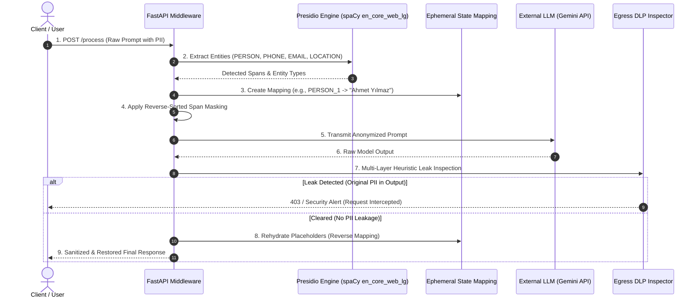

# PII Guard Middleware for LLMs

[](https://www.python.org/)
[](https://fastapi.tiangolo.com/)
[](https://github.com/microsoft/presidio)
[](https://opensource.org/licenses/MIT)
[](https://docs.pytest.org/)

An HTTP proxy middleware built with FastAPI and Microsoft Presidio to implement data minimization for Large Language Model (LLM) integrations. The system anonymizes sensitive Personally Identifiable Information (PII) before external transmission, applies multi-layer heuristic checks on the model's response to detect inadvertent data leakage, and restores original values for the client.

---

## 🏗️ Architecture & Pipeline Flow

The proxy intercepts traffic at two points in the request lifecycle: **Ingress (Pre-LLM)** and **Egress (Post-LLM)**.



---

## ⚙️ Engineering Implementation Details

### 1. Ingress Anonymization (`processor.py`)
* **Entity Extraction:** Integrates `presidio-analyzer` backed by spaCy's `en_core_web_lg` model (`language='en'`). Configured to extract `PERSON`, `PHONE_NUMBER`, `EMAIL_ADDRESS`, and `LOCATION` entities.
* **Deterministic Index Replacement:** Multi-entity replacements introduce character offset shifts. To prevent index corruptions, entity spans are sorted in reverse order (`sorted(results, key=lambda x: x.start, reverse=True)`) before string reconstruction.
* **State Mapping:** Retains a temporary bidirectional dictionary (`{"PERSON_1": "Original Name"}`) scoped to the request execution context.

### 2. Egress DLP Inspection (`dlp_guard.py`)
Model completions are evaluated through a layered heuristic filter prior to rehydration:

* **Case-Insensitive Matching:** Normalizes Unicode (NFKC) and character casing including Turkish letter variations (e.g., `Ahmet Yılmaz` $\leftrightarrow$ `ahmet yılmaz`, `İSMAİL` $\leftrightarrow$ `ismail`).
* **Delimiter & Obfuscation Stripping:** Removes whitespace and punctuation delimiters (`[\W_]+`) to detect separated token patterns (e.g., `F-u-r-k-a-n`, `A h m e t`).
* **Numeric & Phone Chunk Normalization:** Extracts contiguous digit chunks ($\ge 7$ digits) and normalizes non-digit characters (`\D`) to match across local and international formatting (`+90 555 123 4567` $\leftrightarrow$ `05551234567`) while preventing false alarms from scattered numbers.
* **Token-Level Compound Name Heuristics:** Evaluates individual sub-tokens of multi-word names ($\ge 4$ characters) using `\b` word boundaries to catch partial name leaks while avoiding substring collisions (e.g., matching `"Ali"` will not flag `"Kalite"`).
* **Telemetry Logging:** Presidio scans generated text for general world entities (e.g., "Paris", "Albert Einstein"). Unmatched entities are logged as telemetry (`INFO`) without triggering false-positive request blocks.

---

## ⚠️ Scope & Known Technical Limitations

* **Language Model Scope:** Entity recognition relies on spaCy's `en_core_web_lg` model (`language='en'`). Recognition accuracy on non-English text or localized identifiers (e.g., Turkish TCKN, regional tax IDs) requires custom Presidio `PatternRecognizer` definitions.
* **State Storage:** Mapping buffers are currently stored in-memory per request lifecycle. Distributed, multi-worker architectures would require an external key-value store (e.g., Redis) with TTL expiration.
* **Heuristic Boundaries:** Token-level name matching applies a length threshold ($\ge 4$ chars) to reduce collision rates with common vocabulary words.

---

## 🛠️ Tech Stack

* **Language:** Python 3.10+
* **Web Framework:** FastAPI, Uvicorn
* **Privacy & NLP:** Microsoft Presidio Analyzer (`presidio-analyzer`), spaCy (`en_core_web_lg`)
* **LLM Client:** Google Generative AI SDK (`google-generativeai`)
* **Testing:** Pytest

---

## 🚀 Quickstart & Local Setup

### 1. Clone & Environment Setup
```bash
git clone https://github.com/mfurkanerkan15/pii-guard-middleware.git
cd pii-guard-middleware

python -m venv venv
# On Windows:
.\venv\Scripts\activate
# On Linux/macOS:
# source venv/bin/activate

pip install -r requirements.txt
python -m spacy download en_core_web_lg
```

### 2. Configuration
Copy `.env.example` to `.env` and provide your Gemini API key:
```bash
cp .env.example .env
```
Inside `.env`:
```env
GEMINI_API_KEY=your_gemini_api_key_here
```

### 3. Run the Server
```bash
python -m uvicorn main:app --reload
```
API Documentation: [http://127.0.0.1:8000/docs](http://127.0.0.1:8000/docs)

---

## 🧪 Automated Testing

The test suite contains 43 automated tests covering pipeline stages, heuristic leak filters, API responses, and edge cases:

```bash
pytest -v
```

### Test Coverage Overview:
* **Ingress Anonymization & Rehydration:** Validates complete masking-unmasking roundtrip and non-PII pass-through.
* **Case Normalization:** Tests lowercase, uppercase, and mixed-case leakage vectors.
* **Obfuscation Detection:** Tests hyphen, whitespace, dot, and underscore token separation tricks.
* **Numeric & Phone Variations:** Tests international prefix variations, unformatted digits, and hyphenated forms.
* **Token-Level Name Matching:** Tests first-name, middle-name, and surname partial leakage.
* **False-Positive Handling:** Asserts that general world entities (Paris, Einstein) and word substrings ("Kalite" $\neq$ "Ali") are not blocked.
* **Edge Cases & Stress:** Tests JSON-escaped payloads, regex special characters in names, empty buffers, and high-volume text (10,000+ characters).
